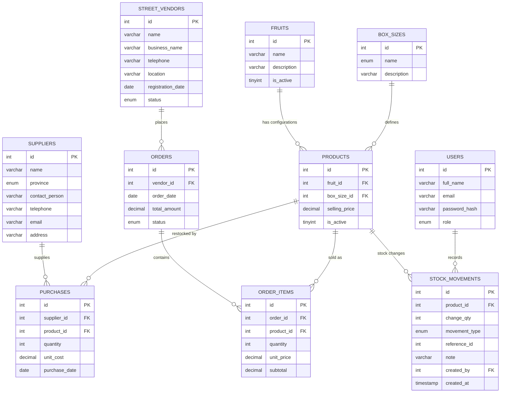

# Batloung Fruits \u2014 Entity Relationship Diagram

## Relationships

- **Supplier \u2192 Purchases (Stock)** : one supplier provides many stock purchases.
- **Fruit \u2192 Products** : one fruit has many Fruit+Box product configurations.
- **Box Size \u2192 Products** : one box size applies to many products.
- **Street Vendor \u2192 Orders** : one vendor places many orders.
- **Orders \u2192 Order Items** : one order contains many order items.
- **Products \u2192 Order Items** : one product appears in many order items.
- **Products \u2192 Stock Movements** : one product has many stock movements; its **available stock is the SUM of `change_qty`** across these rows (not a stored column).
- **Users \u2192 Stock Movements** : one user may record many stock movements (purchases, adjustments).

## Stock as a derived value (normalization note)

Stock level is **not** stored on `products`. It is computed from the
`stock_movements` ledger, where every change is an immutable signed row:

- `initial` / `purchase` / positive `adjustment` -> stock **IN** (`change_qty > 0`)
- `sale` (on order completion) / negative `adjustment` -> stock **OUT** (`change_qty < 0`)

This removes the update anomaly of a mutable running total and gives a full,
auditable history (what changed, why, by whom, and when).
